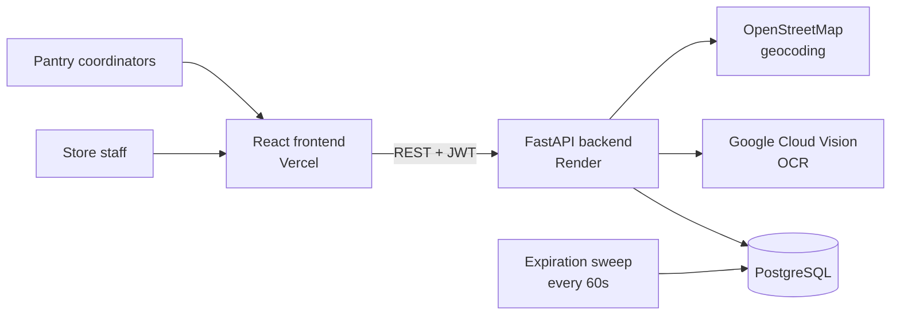
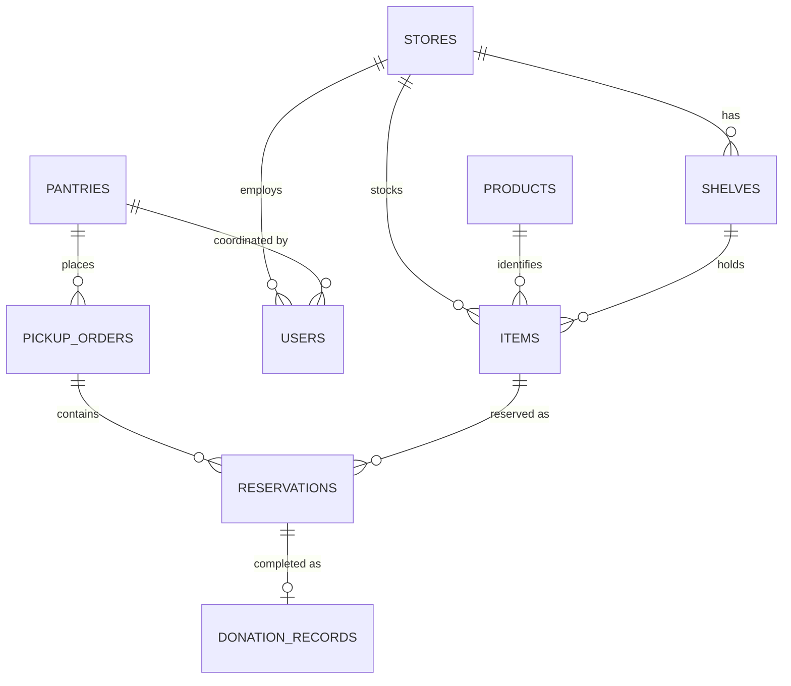
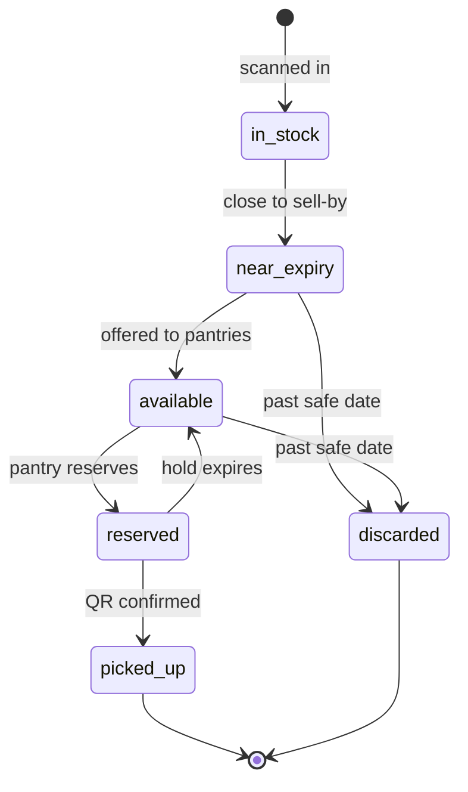

<div align="center">

# 🥫 NourishNet

**Smart-shelf food recovery** — tracks grocery items toward their sell-by date
and hands them to verified food pantries before they're thrown out.

### 🥉 3rd Place — Bridge to Connect Innovation Challenge 2026

**[Live demo →](https://nourish-net-coral.vercel.app)**

</div>

---

## About the project

Grocery stores pull food at its sell-by date, but much of it is still safe to
eat. NourishNet connects that food with local pantries:

1. **Scan in** — store staff scan the barcode and the date label (OCR reads
   the date, a person confirms it).
2. **Track** — each item gets donate and discard deadlines from per-category
   food-safety rules.
3. **Offer** — a background job moves items to the donation network
   automatically when they're due.
4. **Pick up** — pantries find shelves on a map, reserve items, and collect
   them with one QR code.

Built by:
- Jacob Pimentel, Engineering Physics (Vanguard University)
- Harshita Saripalli, Computer Engineering (UC Irvine)
- Vy (Evie) Ho, Computer Science (San Jose State University)
- David Arellano, Mechanical Engineering (CSU Los Angeles)
- Bashar Zaher, Electrical Engineering (CSU Northridge)

## Screenshots

| Sign in | Store dashboard | Pantry dashboard |
|---|---|---|
|  |  |  |

## Architecture



### Layout

```
backend/     FastAPI API — auth, intake, OCR, expiration rules, reservations
frontend/    React app — sign in, store dashboard, intake, pantry dashboard
docs/        functional spec, deploy guide, intake pipeline
```

### Database



### Item lifecycle



## What we used

| Part | Tools |
|---|---|
| Frontend | React 19, Vite, Tailwind CSS, React Router, Leaflet (map), ZXing (barcodes), qrcode.react |
| Backend | Python, FastAPI, SQLAlchemy, Pydantic, JWT + bcrypt |
| Database | PostgreSQL |
| Services | Google Cloud Vision (OCR), OpenStreetMap Nominatim (geocoding) |
| Hosting | Vercel (frontend), Render (API) |

## How to run

**Backend** — from `backend/`

```bash
python -m venv venv
source venv/bin/activate            # Windows: .\venv\Scripts\Activate.ps1
pip install -r requirements.txt
cp .env.example .env                # fill in DATABASE_URL and JWT_SECRET
python -m uvicorn app.main:app --reload
```

API docs at http://localhost:8000/docs.

**Frontend** — from `frontend/`, in a second terminal

```bash
npm install
npm run dev
```

Set `VITE_API_URL` in `frontend/.env` to the API's address.

**Demo data** (optional) — from `backend/`

```bash
python -m scripts.seed_demo         # set DEMO_STAFF_PASSWORD and DEMO_ORG_PASSWORD first
```

See [`docs/deploy.md`](docs/deploy.md) for deployment and
[`docs/functional-spec.md`](docs/functional-spec.md) for the full spec.
