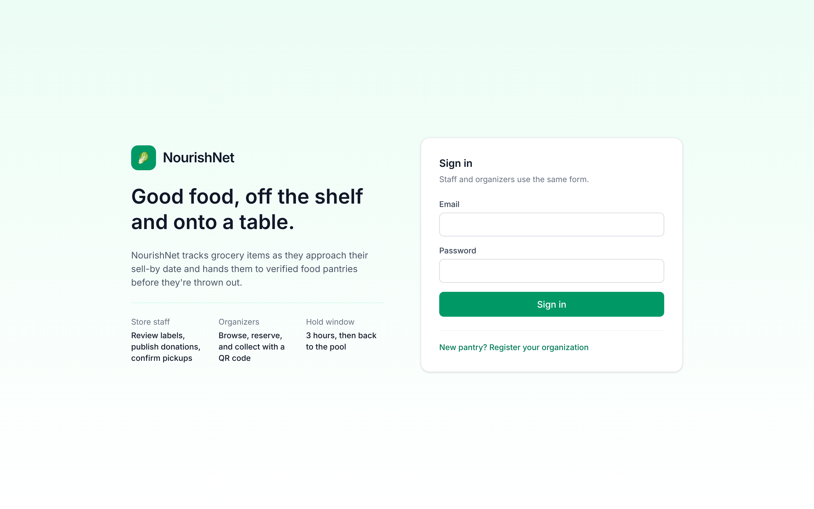
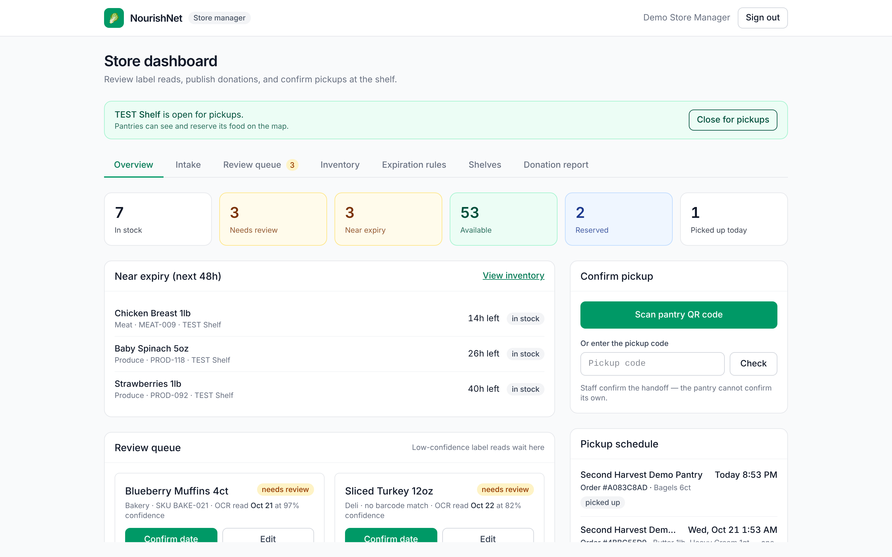
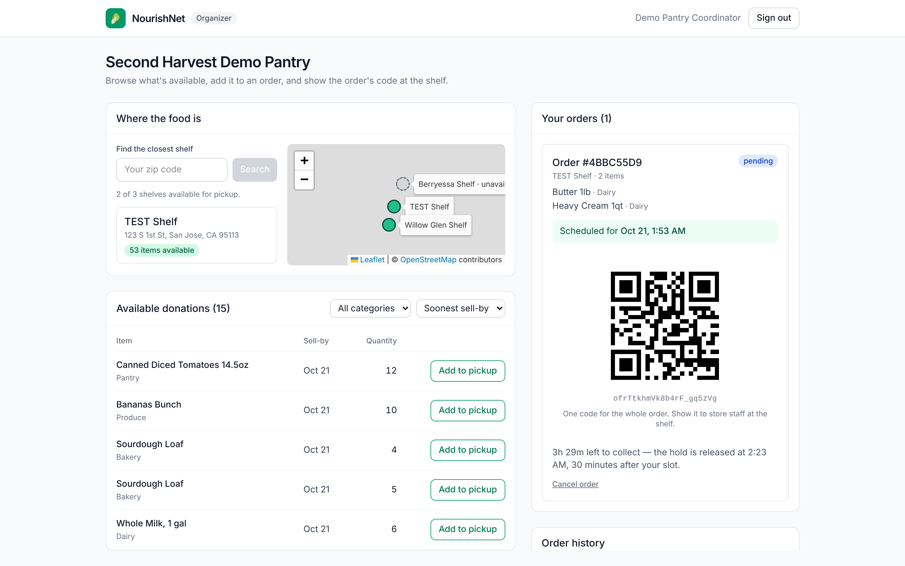
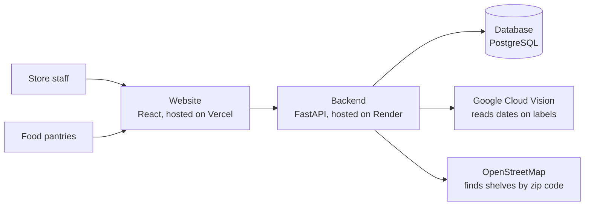
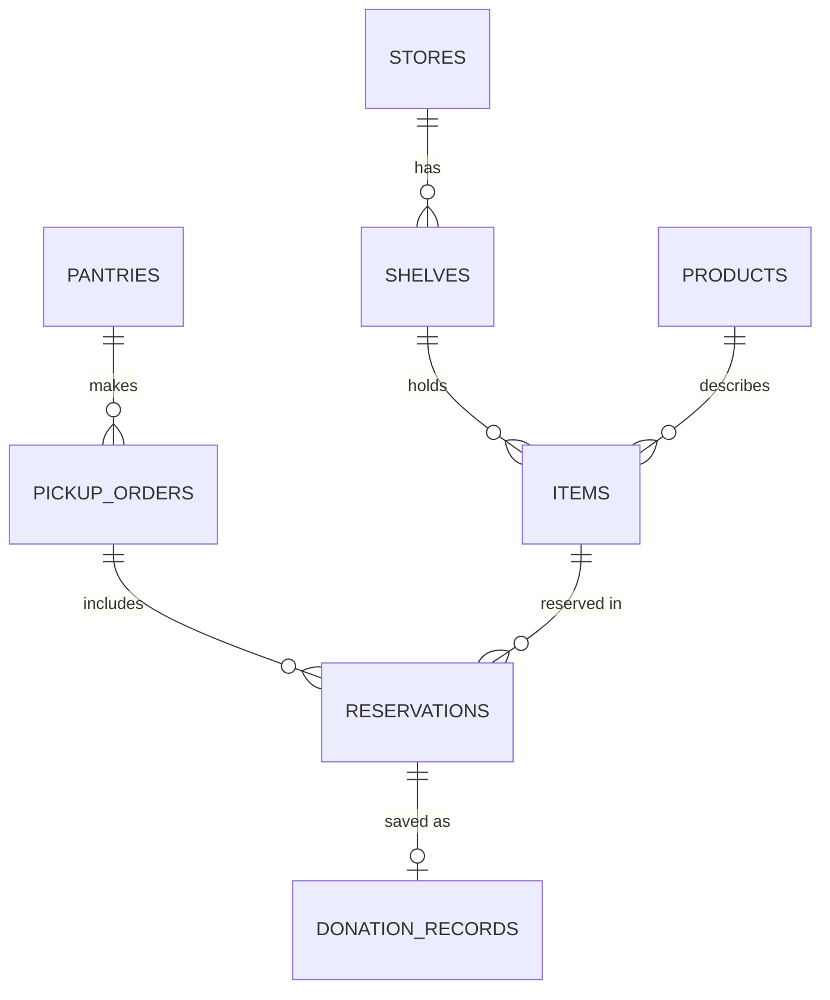
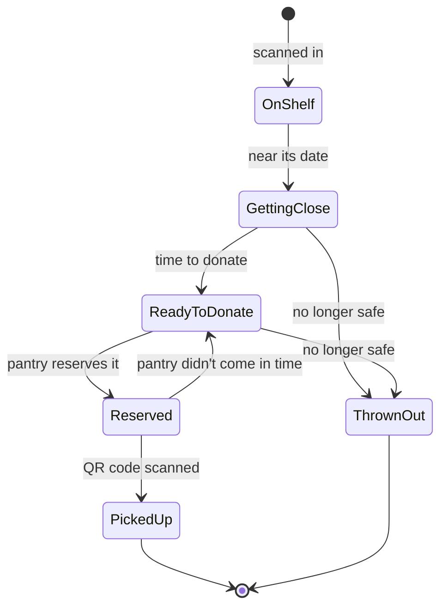

<div align="center">

# 🥫 NourishNet

**Catching food before it becomes waste.**

### 🥉 3rd Place — Bridge to Connect Innovation Challenge 2026

**[Try the live demo →](https://nourish-net-coral.vercel.app)**

</div>

---

## About the project

Grocery stores throw away a lot of food that's still good to eat. In the U.S.
in 2024, retail stores had about **$30.3 billion** worth of extra food, about
**2.7 million tons** of retail food ended up as waste, and **less than 13%**
of food that could have been donated actually was.
*(Sources: ReFED Retail Fact Sheet; Progress on the Plate 2026)*

A big reason is time. Store staff are busy, and keeping track of dates,
deciding what can be donated, and setting up pickups with food pantries is a
lot of extra work.

We built NourishNet to make that easier. It's one place where a grocery store
can:

1. **Scan food** — scan the barcode and the date on the label with a camera
   or scanner. The app reads the date, and a staff member double-checks it.
2. **Track dates** — the app keeps an eye on sell-by and expiration dates and
   lets staff know when food is getting close.
3. **Arrange donations** — when food is ready to donate, it shows up for
   local food pantries automatically.
4. **Confirm pickup** — the pantry reserves the food, picks it up with a QR
   code, and the app saves a record of the donation.

**Who it helps:**

- **Grocers** keep track of food dates and keep all their donation records in
  one place.
- **Pantries** can see what food is available nearby and set up pickups.
- **Communities** get more food to people who need it, and less of it goes to
  waste.

### Our team

We're five students from different schools and majors. We worked together
online for five months before meeting in person at the competition.

- Jacob Pimentel, Engineering Physics (Vanguard University)
- Harshita Saripalli, Computer Engineering (UC Irvine)
- Vy (Evie) Ho, Computer Science (San Jose State University)
- David Arellano, Mechanical Engineering (CSU Los Angeles)
- Bashar Zaher, Electrical Engineering (CSU Northridge)

## Screenshots

| Sign in | Store dashboard | Pantry dashboard |
|---|---|---|
|  |  |  |

## How it's built

The app has two parts: a **website** that people use, and a **backend** that
does the work behind the scenes and stores the data.



### Folders

```
backend/     the server: sign-in, scanning, date rules, donations
frontend/    the website: sign-in page, store dashboard, pantry dashboard
docs/        project spec, deploy guide, screenshots
```

### Database

The main things we store and how they connect:



### What happens to a food item

Every minute, the backend checks every item's dates and moves it to the next
step when it's time.



Some food, like baby formula, is never offered automatically. A staff member
always has to approve it first.

## What we used

| Part | Tools |
|---|---|
| Website | React, Vite, Tailwind CSS, Leaflet (map), ZXing (barcode scanning) |
| Backend | Python, FastAPI, SQLAlchemy |
| Database | PostgreSQL |
| Other services | Google Cloud Vision (reading label dates), OpenStreetMap (maps) |
| Hosting | Vercel (website), Render (backend) |

## How to run it

You'll need **Python** and **Node.js** installed. Open two terminals, one
for the backend and one for the website.

**1. Backend** (in the `backend/` folder)

```bash
python -m venv venv
source venv/bin/activate            # on Windows: .\venv\Scripts\Activate.ps1
pip install -r requirements.txt
cp .env.example .env                # then add your DATABASE_URL and JWT_SECRET
python -m uvicorn app.main:app --reload
```

The backend runs at http://localhost:8000. You can see all the API routes at
http://localhost:8000/docs.

**2. Website** (in the `frontend/` folder)

```bash
npm install
npm run dev
```

In `frontend/.env`, set `VITE_API_URL=http://localhost:8000` so the website
talks to your local backend. Then open http://localhost:5173.

**3. Add demo data** (optional, in the `backend/` folder)

```bash
python -m scripts.seed_demo
```

This adds sample stores, shelves, food items and two demo accounts. Set
`DEMO_STAFF_PASSWORD` and `DEMO_ORG_PASSWORD` in `.env` first so you can sign
in with them.

---

More details: [deploy guide](docs/deploy.md) ·
[full project spec](docs/functional-spec.md)
